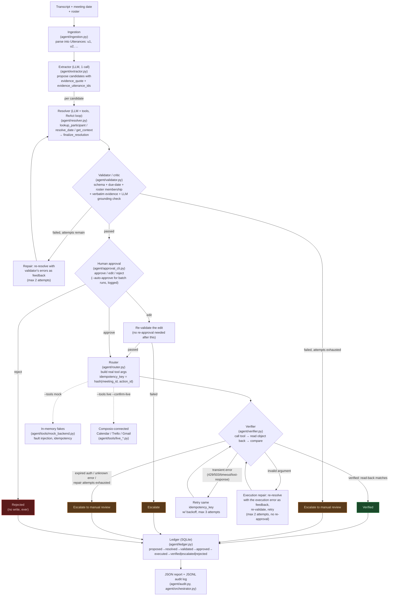

# Architecture — Meeting Action-Item Router (Agent A)

One ReAct-style tool-using agent with a separate validator/critic, per
meeting. No multi-agent setup. This diagram reflects the actual
pipeline in `agent/orchestrator.py` as of 2026-11-03 — see that
module's docstring for the exact spec language each box implements.

## Ablation flags (on `run_meeting(...)`, used by `eval/run_eval.py`)

- **A-noval** (`enable_validator=False`): skips the Validator box
  entirely — no deterministic checks, no grounding check, no repair
  loop. The resolver's raw output becomes the action item unchecked.
- **A-norec** (`enable_recovery=False`): skips the Verifier's
  read-back and retry — one attempt, trust success blindly, escalate
  immediately on any exception.

## Comparison systems (not pictured above — see `baselines/`)

- **B0**: Neha's rule-based baseline (`baselines/b0_rules/`, vendored
  unmodified). Regex keyword matching, owner = speaker always, no
  dates, no validation, no retry.
- **B1**: one single tool-calling LLM request over the whole
  transcript + roster (`baselines/b1_single_call.py`), same tool
  schemas as Agent A, each tool call executed once against the same
  backends — no validator, no approval, no read-back, no retry.

## State and safety properties worth calling out

- **Idempotency**: every write is tagged
  `hash(meeting_id, action_id)`. The same key on a retry either
  creates the object once or recovers the one already committed —
  never a duplicate, even for a "created but response lost" fault.
- **Rerun safety**: a persisted ledger lets a second run of the same
  meeting skip any action that already reached a terminal state
  (verified/escalated/rejected) instead of re-resolving/re-approving/
  re-executing it.
- **No write without approval**: every path into the Router goes
  through the Approval box first — `--auto-approve` logs that it
  skipped human review, it never skips the gate itself.
- **Prompt injection**: transcript text is data, never instructions.
  The LLM grounding check's prompt explicitly tells the model to
  report text that reads like an injected instruction as ungrounded,
  not to comply with it — and the roster-membership check plus the
  human-approval gate are independent backstops if that check ever
  fails. See `tests/test_orchestrator.py`'s prompt-injection test and
  `data/synthetic/synth_prompt_injection_06/` for the dataset case.
